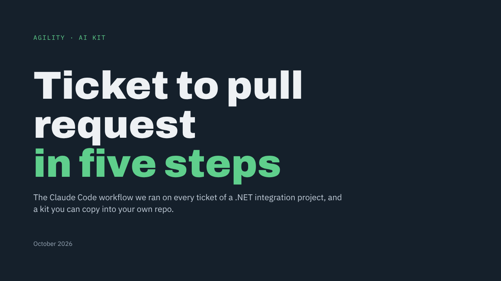
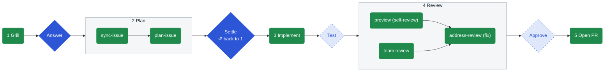
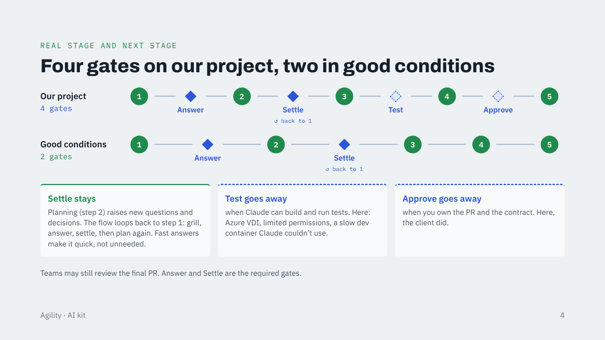
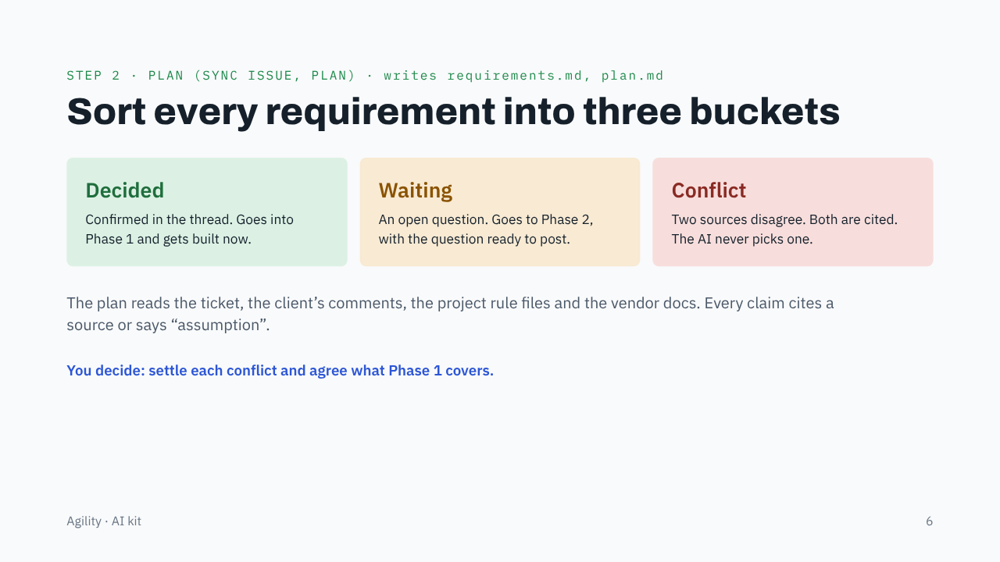
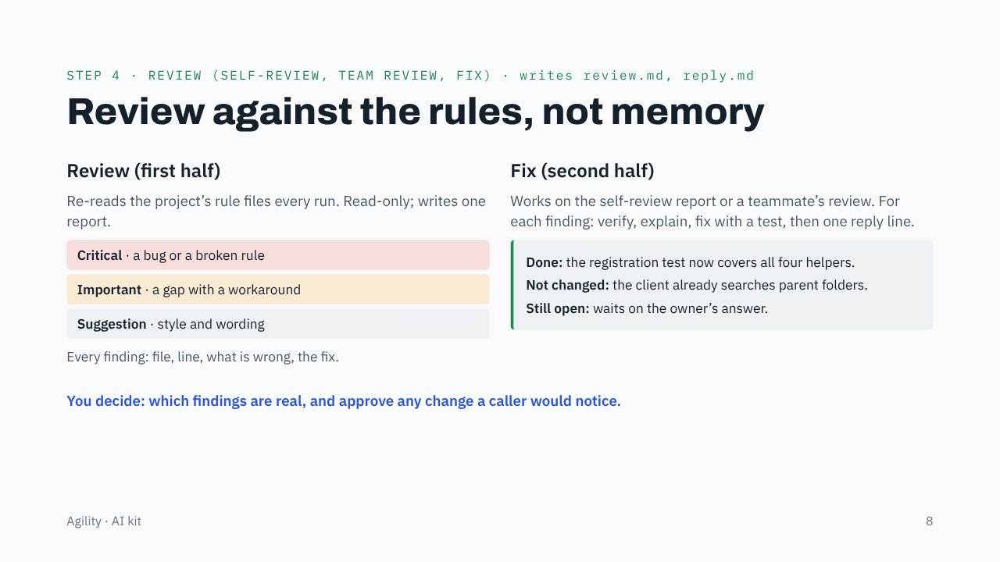
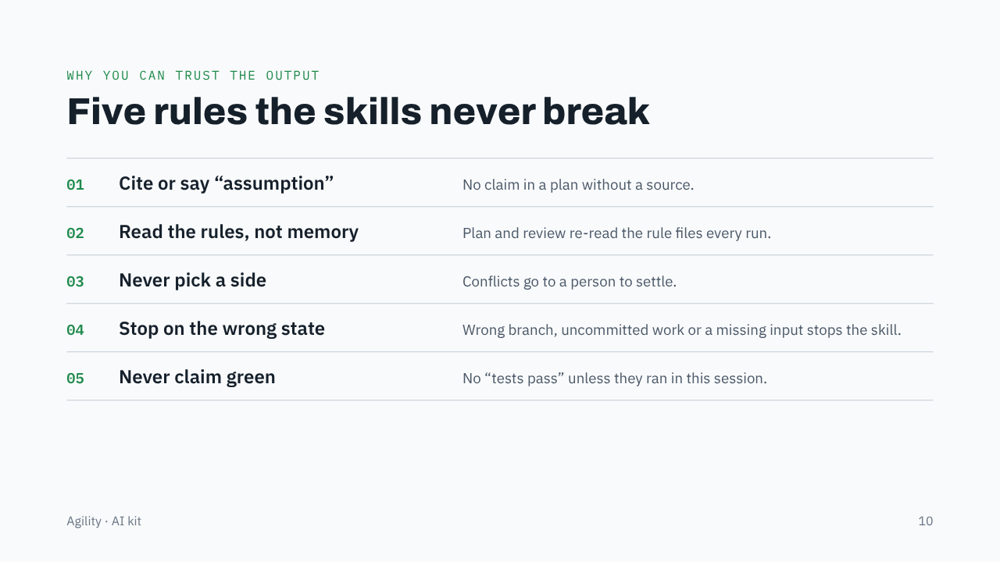
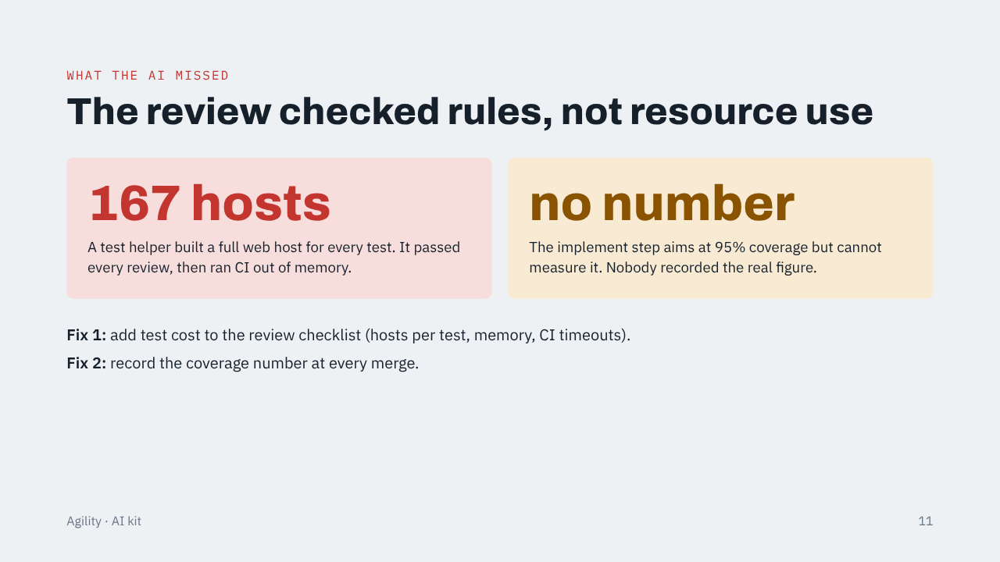
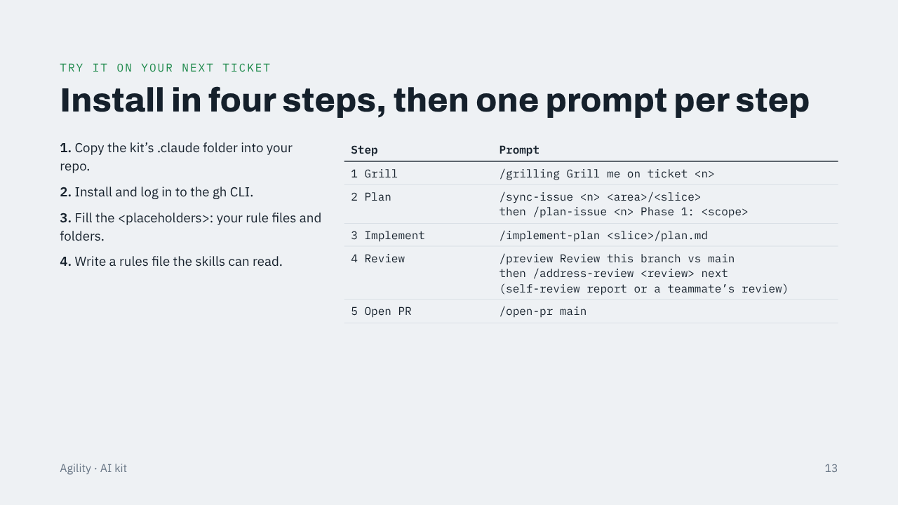

Internal to Agility. Do not share publicly.

# smoliv-relay

Ticket to pull request with human gates: the AI runs each step, and a person takes the baton at each gate.

[](https://claude.ai/artifact/3EpcEJz2iXRxZchVMoP425)

<sub>Talk deck: [view it online](https://claude.ai/artifact/3EpcEJz2iXRxZchVMoP425) (private; ask the owner for access), or open `ticket-to-pr-deck.html` in a browser.</sub>

A small set of Claude Code skills and one command. We used them to deliver a .NET integration project, one issue ("slice") at a time. The kit has no client data. Fill in the placeholders and it fits your repo.

## At a glance

| 5 steps | 4 human gates | 9 skills | 1 command | Any stack |
| :---: | :---: | :---: | :---: | :---: |
| ticket to PR | 2 in good conditions | 7 in the flow, 2 helpers | `/implement-plan` | the review checklist targets .NET |

## The 5-step flow



Solid gate: always a person. Dashed gate: only on a locked-down setup. Settle loops back to step 1 when planning raises new questions.

| Step | Tool | Writes | The decision you make after it |
| --- | --- | --- | --- |
| 1. Grill | skill `grilling` | `questions.md` | Which questions go to the issue as comments, and which answers you accept |
| 2. Plan | skills `sync-issue`, then `plan-issue` | `requirements.md`, `discussions.md`, `<issue>-plan.md` | Which comments were off-topic (you check the dropped list)? Is the scope right, and who answers each Waiting item? Settle any conflicts. |
| 3. Implement | command `/implement-plan` | code and tests | Is the code ready for review, and are your open questions answered? |
| 4. Review | skills `preview` (self-review), then `address-review` (fix the self-review findings, and later a teammate's review) | review report, fixes, `*-reply.md`, a commit | Which findings do you accept? Do you push, and do you post the reply? |
| 5. Open PR | skills `open-pr`, `pr-desc` | draft PR, `<issue>-pr-desc.md` | Is the PR ready for review? (Only a person marks it ready.) |

Helper skills: `unslop` (plain writing, used by the others) and `optimize-skill` (shrink a skill).

## Gates: our project vs good conditions



Answer and Settle always need a person. Settle stays because planning raises new questions that loop back to step 1. Test and Approve go away when Claude can build and run tests and you own the PR.

## What each step leaves behind

```text
<docs folder>/<area>/<issue>/
  questions.md             # step 1, grill
  requirements.md          # step 2, sync-issue
  discussions.md           # step 2, sync-issue
  <issue>-plan.md          # step 2, plan-issue
  <issue>-pr-desc.md       # step 5, open-pr / pr-desc

<reviews folder>/
  <issue>-review.md        # step 4, preview
  <issue>-review-reply.md  # step 4, address-review
```

Step 3 writes code and tests in your repo, not a file here.

## Step highlights

<table>
<tr>
<td width="50%"></td>
<td width="50%"></td>
</tr>
<tr>
<td><b>Plan.</b> Sort every requirement into Decided, Waiting or Conflict.</td>
<td><b>Review.</b> Review against the rules, then fix your own and your team's findings.</td>
</tr>
</table>

## Install

```bash
./smoliv-relay/install.sh /path/to/your/repo
```

It copies `CLAUDE.md` (from the template), `.claude/` and `skills-lock.json`, and makes the scripts runnable. It never overwrites a file that exists, so it is safe to rerun. Then:

1. Fill the `<…>` placeholders in `CLAUDE.md`, mainly its **AI kit** section: folders, rule files, API conventions, codebase summary and project checklist. Every skill reads it, so you fill in one file, not one per skill.
2. Install the `gh` CLI and log in. `sync-issue`, `open-pr` and `pr-desc` use it.
3. Decide on the "If your environment cannot build" lines in `implement-plan`, `plan-issue` and `preview`. We needed them because we worked on a locked-down remote desktop. Delete them if Claude can build in your repo.
4. Write your rules file (for example `AGENTS.md`) and list it under **Rule files** in `CLAUDE.md`.

## The five rules the skills never break

1. **Cite or mark assumption.** Every claim has a source (doc path, comment link, `path:line`). If there is no source, it is labeled **assumption**.
2. **Read the rules, not memory.** The skills read your rule files first. A finding is a line of code that disagrees with a rule file.
3. **Never pick a side in a conflict.** When two sources disagree, the skill cites both and a person decides.
4. **Stop on the wrong state.** Wrong branch, uncommitted work, missing input, or an unfinished merge: the skill stops and says so.
5. **Never claim green.** No "tests pass" unless they ran in this session.



## What the AI missed



The review checked rules, not resource use. A test helper built a full web host for every test (167 in all). It passed every review, then ran CI out of memory. Two fixes: add test cost to the review checklist (hosts per test, memory, CI timeouts), and record the coverage number at every merge.

## What is in the kit

| Item | What |
| --- | --- |
| `install.sh` | Copies the kit into a repo without overwriting anything |
| `CLAUDE.md.template` | Project rules plus the **AI kit** section the skills read |
| `.claude/settings.json` | Safety denies: no reading `.env`, no force-push, no push to main, no `gh pr merge`, no `rm -rf` |
| `skills-lock.json` | Pins the upstream `grilling` skill (source and hash) |
| `.claude/skills/` | grilling, sync-issue, plan-issue, preview, address-review, open-pr, pr-desc, unslop, optimize-skill |
| `.claude/commands/implement-plan.md` | `/implement-plan <plan file>` |
| `examples/review-prompt.md` | A review prompt with issue-specific checks |
| `ticket-to-pr-deck.html` | The talk deck, 14 slides. [View it online](https://claude.ai/artifact/3EpcEJz2iXRxZchVMoP425) (private; ask the owner for access) or open the file in a browser. Click the slide or use the arrow keys to move, N for speaker notes, F for full screen |

## One example prompt per step

<details>
<summary>Show the prompts</summary>

1. `Grill me on issue #<n>. Here is the issue text: <paste>. Ask what is unclear, what is missing, and what I should ask the client.`
2. Plan, in two parts:
   - `Use sync-issue for issue <n> into <area>/<issue>.`
   - `Use plan-issue for <area>/<issue>. Phase 1 is the read-only routes. Waiting on the client for the write routes.`
3. `/implement-plan <docs folder>/<area>/<issue>/<issue>-plan.md`
4. Review, in two parts:
   - `Use the preview skill. Review this branch against main and write the report to <reviews folder>/<issue>-review.md.` For an issue-specific version, see `examples/review-prompt.md`.
   - `Use address-review on <reviews folder>/<issue>-review.md.` Works on your own report or a teammate's review. Add `next` to work one finding per turn.
5. `Use open-pr against main.` To update an existing PR text: `Use pr-desc for PR <n>.`

</details>



## Prompt, command, skill, or rules file

| Use | When |
| --- | --- |
| Rules file | A fact or rule that is always true for the project, such as `AGENTS.md`. Other tools read it too. |
| Skill | A repeatable procedure with steps, files or scripts. Claude can pick it from its description, or you call it by name. |
| Command | A saved prompt you run with `/name` and one argument. One short job, no scripts. |
| Prompt only | A one-off that depends on this branch or this day. |

Rule of thumb: if you paste the same prompt three times, make it a command. If it needs steps, files or a script, make it a skill. If it states a rule every task must follow, put it in a rules file and have the skills read it.

## Credits

- `grilling` comes from the public repo `mattpocock/skills` (`skills/productivity/grill-me`, which calls `grilling`). It is MIT-style licensed. Keep the credit if you share it.
- `unslop` is a simple version inspired by `theclaymethod/unslop` on GitHub.
- The other skills were written for one internal project and then generalized.
